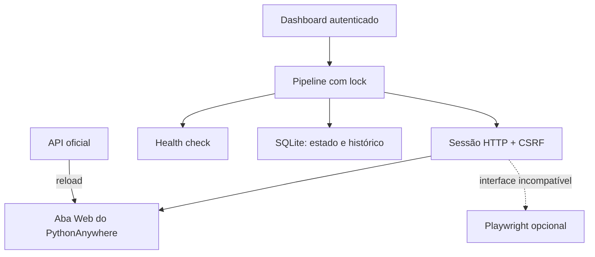

# PA Manager

> **Status: ativo e em uso.** Projeto de automação operacional mantido recentemente para deploy serverless no Railway e gerenciamento seguro de múltiplas aplicações.

### Portfolio snapshot

Este projeto demonstra **automação de navegador/HTTP autenticado, segurança de credenciais, jobs concorrentes, observabilidade, testes, Docker e deploy em produção**. O diferencial é tratar uma rotina operacional real com mecanismos de segurança como dry-run, locks, validação pós-ação e fallback controlado.


Painel pessoal para verificar, renovar e recarregar web apps gratuitos do PythonAnywhere em contas independentes. O projeto vem configurado com os 18 domínios informados, inicia obrigatoriamente em **DRY RUN** e mantém senhas e tokens fora do código, do navegador e do banco de dados.

## Problema, público e resultado

**Problema.** Aplicações gratuitas do PythonAnywhere expiram se não forem renovadas, e renovar uma a uma, em várias contas, é repetitivo e fácil de esquecer.

**Para quem.** Quem mantém várias aplicações no plano gratuito do PythonAnywhere. O README lembra que os termos do serviço prevalecem.

**O que entrega.** Painel e CLI que acompanham a validade de cada aplicação, renovam pela interface autenticada confirmando a nova data e registram as execuções, com modo de simulação (`DRY_RUN`) ligado por padrão e lista de contas permitidas.

**Tecnologias.** Python, FastAPI, Playwright, SQLite, Docker, Railway, GitHub Actions.

**Qualidade e evidências.** 30 funções de teste automatizadas; workflow de testes; `SECURITY.md`; credenciais apenas por variáveis de ambiente.

## Decisão técnica — agosto de 2026

| Alternativa | O que foi confirmado | Decisão |
|---|---|---|
| API oficial | A API v0 documenta listagem/configuração, `enable`, `disable` e `reload`, mas não documenta `expiry` nem uma ação de extensão mensal. | Usada para `reload` e para reativar um app explicitamente desabilitado quando há token; não é usada para inventar uma renovação inexistente. |
| HTTP autenticado da interface | A aba Web publica um formulário protegido por sessão e CSRF cuja ação contém `/webapps/{domain}/extend/`. O PA Manager descobre a URL e todos os campos no HTML; não fixa um endpoint secreto como se fosse API pública. | Mecanismo principal de renovação, com confirmação por nova leitura da data. |
| Playwright | Reproduz o uso do navegador e tolera algumas mudanças visuais, mas é mais pesado, lento e sujeito a alterações de seletores. | Fallback opcional, desabilitado por padrão. Nunca contorna CAPTCHA ou 2FA. |
| GitHub Actions + navegador/script | Guarda secrets de modo adequado e é ótimo para execução eventual, mas um painel que o dispare precisaria de mais um token GitHub e de sincronização de histórico. | Workflow manual incluído como alternativa; não é o backend principal do painel. |

A escolha é coerente com três fontes atuais do próprio PythonAnywhere:

- a [documentação oficial da API](https://help.pythonanywhere.com/pages/API/) lista `enable` e `reload`, mas não uma extensão de validade;
- a [página de recursos das contas gratuitas](https://help.pythonanywhere.com/pages/FreeAccountsFeatures/) registra um web app, um worker e expiração de um mês;
- em [resposta pública de março de 2026](https://www.pythonanywhere.com/forums/topic/36620/), um membro da equipe explicou que fazer login **ou executar um script** demonstra que o usuário ainda se importa com o app.

O formulário autenticado não é uma API pública e pode mudar. Por isso o código o descobre em cada sessão, valida CSRF, confirma a data depois da ação, oferece fallback visual e falha de modo explícito se a interface não puder ser reconhecida. Os [termos do serviço](https://www.pythonanywhere.com/terms_v2/) continuam prevalecendo; mantenha baixo volume, credenciais protegidas e revise mudanças futuras da documentação.

## O que está pronto

- dashboard responsivo com 18 projetos;
- login próprio do PA Manager, cookie `HttpOnly`, `SameSite=Strict`, CSRF e rate limit de login;
- **Verificar todos**, renovação individual/global e `reload` individual;
- `DRY_RUN=true` por padrão e bloqueios adicionais para ações reais;
- processamento independente por conta, concorrência limitada e lock contra clique duplicado;
- leitura de expiração, cálculo de dias restantes e classificação ativo/atenção/expirado;
- health check com 2xx/3xx, redirects limitados à mesma origem, tempo de resposta e status HTTP;
- histórico persistente em SQLite;
- logs JSON sem passwords, tokens ou cookies;
- uso opcional da API oficial para `reload` e reativação;
- fallback Playwright opcional;
- CLI, Docker, Railway e workflow manual do GitHub Actions;
- testes unitários e de integração isolada, sem login real.

## Arquitetura



O processo roda com **um worker e uma réplica**. Isso preserva o lock local, os jobs em segundo plano e o SQLite. Cada conta recebe uma sessão própria e uma falha não interrompe as demais.

## Instalação local

Requisitos: Python 3.11+ (recomendado 3.12).

```bash
python -m venv .venv
source .venv/bin/activate
pip install -e ".[dev]"
cp .env.example .env
```

Gere uma chave de sessão:

```bash
python -c "import secrets; print(secrets.token_urlsafe(48))"
```

Copie o valor para `PAM_SESSION_SECRET`, defina uma senha exclusiva em `PAM_ADMIN_PASSWORD` e preencha as credenciais PythonAnywhere no `.env`. Esses campos vêm vazios e o servidor se recusa a iniciar sem valores seguros. O arquivo já está ignorado pelo Git.

Valide tudo sem exibir secrets:

```bash
pa-manager validate-config
```

Inicie o painel:

```bash
uvicorn pa_manager.web:create_app --factory --reload
```

Abra `http://127.0.0.1:8000`.

## Secrets das contas

Cada entrada de `config/accounts.yaml` aponta para nomes de variáveis, nunca para valores:

```yaml
- id: mapdcasos
  username: mapdcasos
  domain: mapdcasos.pythonanywhere.com
  password_env: PA_MAPDCASOS_PASSWORD
  token_env: PA_MAPDCASOS_API_TOKEN
```

A senha é necessária para consultar a expiração e renovar pela interface autenticada. O API token é opcional e serve preferencialmente para `reload` e para reativar pela API oficial um app que continue desabilitado depois da extensão.

Em hospedagens que facilitam um único secret, também é aceito `PAM_CREDENTIALS_JSON`:

```json
{
  "rodrigoniskier": {"password": "...", "api_token": "..."},
  "mapdcasos": {"password": "...", "api_token": "..."}
}
```

Uma variável individual, quando presente, tem prioridade sobre o JSON.

## Sequência segura do primeiro uso

### 1. Validar a configuração

```bash
pa-manager validate-config
```

O resultado esperado é `18 contas` e a quantidade de contas cujos secrets já existem.

### 2. Fazer o DRY RUN completo

Mantenha:

```env
DRY_RUN=true
PAM_ALLOW_GLOBAL_RENEW=false
PAM_ALLOW_RELOAD=false
PAM_BROWSER_FALLBACK=false
```

No painel, clique em **Simular renovação de todos**, ou use:

```bash
pa-manager renew --all
```

O sistema autentica, abre a aba Web, lê a expiração, localiza a ação que usaria e executa o health check. Ele não envia o POST de renovação.

### 3. Testar uma única conta de verdade

Escolha a conta-piloto e ajuste:

```env
DRY_RUN=false
PAM_ALLOW_GLOBAL_RENEW=false
PAM_ALLOW_RELOAD=false
PAM_ALLOWED_REAL_ACCOUNTS=rodrigoniskier
```

Reinicie o serviço e execute:

```bash
pa-manager renew --account rodrigoniskier --real
```

O teste só é considerado aprovado quando o relatório trouxer a data anterior, a nova data e o health check. Se a data já estiver no máximo permitido, a ação pode ser aceita sem alteração; isso aparece como atenção, não como confirmação falsa.

### 4. Liberar o botão global

Somente depois do teste individual:

```env
DRY_RUN=false
PAM_ALLOW_GLOBAL_RENEW=true
PAM_ALLOW_RELOAD=true
PAM_ALLOWED_REAL_ACCOUNTS=*
```

Reinicie o PA Manager. O botão passa a executar a renovação real para todos, ainda com lock e concorrência máxima de três contas.

## Operações por CLI

```bash
# Verificar todas
pa-manager verify --all

# Verificar uma
pa-manager verify --account mapdcasos

# Simular renovação de todas (sempre dry run sem --real)
pa-manager renew --all

# Renovar uma de verdade, sujeito aos bloqueios do .env
pa-manager renew --account rodrigoniskier --real

# Reload individual; exige DRY_RUN=false, PAM_ALLOW_RELOAD=true e conta autorizada
pa-manager reload --account mapdcasos
```

## Adicionar uma nova conta

1. Acrescente uma entrada em `config/accounts.yaml`.
2. Crie as variáveis de senha e token no ambiente.
3. Rode `pa-manager validate-config`.
4. Execute DRY RUN somente para o novo `id`.

Não é preciso alterar a lógica principal.

## Docker

```bash
cp .env.example .env
docker compose up --build -d
```

O Compose expõe o painel apenas em `127.0.0.1:8000`, elimina capabilities, usa filesystem somente leitura e persiste o SQLite em volume próprio.

Se o fallback visual se tornar necessário, troque o build para `Dockerfile.playwright` e defina `PAM_BROWSER_FALLBACK=true`. A imagem fica substancialmente maior; use isso apenas se a camada HTTP autenticada sinalizar mudança de interface.

## Deploy recomendado

### Railway Free + Serverless com volume persistente

O PA Manager é adequado ao modo **Serverless** do Railway porque não mantém conexões externas, telemetria ou polling em segundo plano quando está ocioso. O SQLite permanece em volume persistente e a aplicação acorda quando o painel recebe tráfego.

1. Use um repositório **privado**.
2. Crie ou mantenha o serviço a partir deste repositório.
3. Adicione **um único volume** montado em `/data` e mantenha `PAM_DB_PATH=/data/pa_manager.db`.
4. Cadastre as variáveis de `.env` no painel da hospedagem.
5. Defina `PAM_SECURE_COOKIES=true`.
6. Defina `PAM_TRUSTED_HOSTS` com o hostname real, sem `https://`.
7. Defina `PAM_TRUSTED_PROXY_HOPS=1` no Railway: o rate limit usa o endereço mais à direita acrescentado pelo único edge proxy.
8. Mantenha exatamente **uma réplica e um worker**.
9. Em **Settings > Deploy > Serverless**, habilite Serverless.
10. Faça um novo deploy depois de habilitar Serverless; a configuração só passa a valer em containers criados depois da alteração.

O `docker-entrypoint.sh` trata o volume do Railway, que é montado como `root`: ele ajusta somente o diretório persistente e em seguida inicia o PA Manager como o usuário não privilegiado `pam`. Não é necessário executar toda a aplicação como root.

No primeiro acesso depois de um período de sono pode haver atraso de cold start e, excepcionalmente, a primeira requisição pode retornar 502; recarregue a página uma vez. O banco em `/data` não é perdido quando o serviço dorme.

Faça o primeiro redeploy ainda com `DRY_RUN=true` e valide `/readyz` antes de liberar renovação real.

## GitHub Actions manual

O workflow `.github/workflows/manual-renew.yml` oferece `verify`, `renew-dry-run` e `renew-real`, com alvo individual ou `all`.

A opção `renew-real` é a única que inicia o job com `DRY_RUN=false`; ela continua sujeita à lista `PAM_ALLOWED_REAL_ACCOUNTS` e, no escopo global, a `PAM_ALLOW_GLOBAL_RENEW=true`.

Configure:

- um Environment chamado `pa-manager-production`, restrito ao branch padrão e com aprovação obrigatória;
- o secret `PAM_CREDENTIALS_JSON` **nesse Environment**, não como secret geral do repositório;
- variable `PAM_ALLOWED_REAL_ACCOUNTS`;
- variable `PAM_ALLOW_GLOBAL_RENEW`.

O workflow sempre faz checkout do branch padrão e só recebe a credencial depois das regras do Environment. Não há `schedule` habilitado. Isso mantém a decisão manual solicitada. O histórico SQLite do workflow é efêmero e não alimenta o dashboard; por isso essa opção é uma contingência, não a arquitetura principal.

## Testes e qualidade

```bash
ruff check .
pytest --cov=pa_manager --cov-report=term-missing
```

Os testes cobrem configuração, datas, parser da aba Web, garantia de não enviar renovação no DRY RUN, health check com redirect, lock, persistência, isolamento de falhas e autenticação do painel.

## Troubleshooting

### “Senha ainda não configurada”

Confira o nome exato de `password_env` no YAML e reinicie o processo depois de criar a variável.

### “Login recusado”

Teste a credencial manualmente. Não cole a senha em logs ou issues. Se houver CAPTCHA/2FA/challenge, conclua o acesso manualmente; o PA Manager não tenta contorná-lo.

### “A ação de renovação não foi localizada”

A interface provavelmente mudou. Primeiro atualize o código/parser. Como contingência, instale `.[browser]`, execute `playwright install chromium` e habilite `PAM_BROWSER_FALLBACK=true`.

### Data não mudou

Se a data já corresponde aproximadamente a um mês a partir de hoje, o PythonAnywhere pode ter atingido o limite máximo. O PA Manager registra atenção. Não repita cliques cegamente.

### Site não respondeu após renovar

Renovação e disponibilidade são verificações distintas. Abra o log do web app, verifique erros de aplicação e só então use `reload`. O PA Manager não mascara uma falha do código como sucesso de renovação.

### “Já existe uma operação em andamento”

O lock impede duplicidade. Aguarde a conclusão. Locks abandonados expiram conforme `PAM_LOCK_TTL_SECONDS`; execuções interrompidas são marcadas no próximo startup.

## Segurança operacional

- nunca faça commit de `.env`, cookies, passwords ou tokens;
- use senha exclusiva no painel e TLS em produção;
- mantenha `PAM_ALLOW_RELOAD=false` até precisar dessa ação e autorize contas com `PAM_ALLOWED_REAL_ACCOUNTS`;
- configure `PAM_TRUSTED_PROXY_HOPS` apenas de acordo com a cadeia real de proxies; valores errados tornam o IP do rate limit não confiável;
- mantenha o repositório privado;
- limite acesso à hospedagem e aos secrets;
- faça backup dos projetos e do banco: o próprio PythonAnywhere ressalta que o usuário é responsável pelos backups;
- revise os termos e a documentação do PythonAnywhere antes de habilitar qualquer agenda automática futura.
